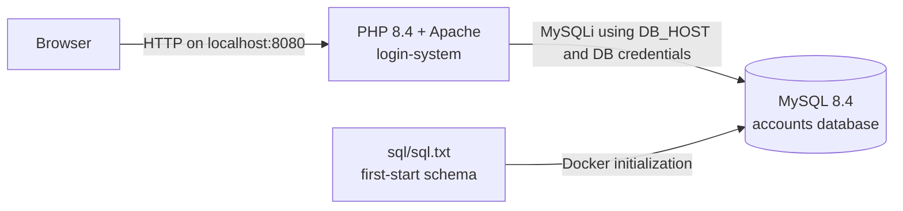

# Login and Signup System

A small PHP and MySQL account application with registration, email verification, login, password reset, and session-based profile pages. The login's parameterized email lookup was already present on the base branch before this PR. This PR adds a shared credential-check function, expands database-backed regression coverage, and provides a Docker Compose development setup.

## Highlights

- Login retrieves an account with a MySQLi prepared statement and a bound email value (pre-existing on the base branch).
- Passwords are verified with PHP's `password_verify()`.
- Authentication lookup and credential decisions live in `login-system/auth.php` and are exercised by a regression test.
- Database connection settings are read from environment variables; credentials are not committed.

## Architecture



The browser submits login and registration forms to `index1.php`. That entry point loads the database connection and starts the PHP session, then dispatches the request to `login.php` or `register.php`. Login calls `checkLoginCredentials()` in `auth.php`; `findUserByEmail()` retrieves an exact email using a bound MySQLi parameter, and `password_verify()` checks the stored password hash. A successful result populates the session and redirects to the profile page; failures redirect to the error page. MySQL stores users in the `accounts` database. Compose loads `login-system/sql/sql.txt` when it initializes a new database volume.

```text
POST /index1.php
  |-- login  -> login.php -> auth.php -> prepared SELECT -> password_verify
  |-- signup -> register.php
  |
  +-- PHP session -> profile.php or error.php
          |
          +-- MySQL service (private Compose network)
```

## Run with Docker Compose

Requirements: Docker Desktop (or Docker Engine with Compose).

From the repository root:

```sh
docker compose up --build -d
```

Open <http://127.0.0.1:8080/index1.php>. The app is served by PHP 8.4 with Apache; MySQL 8.4 is reachable only inside the Compose network. The database is persisted in the `accounts-db` named volume. The default password is for local development only. To override it, set `DB_PASSWORD` in your shell or a local `.env` file before starting Compose. Never use the default credentials for a public deployment.

Stop the containers with `docker compose down`. To reset the local database and rerun schema initialization, use `docker compose down --volumes`; this deletes the Compose database volume.

## Run the login regression test

The test inserts a uniquely named account inside a transaction and rolls it back afterward. Start the Compose services, then run it against the Compose database:

```sh
docker compose exec -T app php tests/login_query_regression.php
```

It calls `checkLoginCredentials()` against the database to check valid credentials, a wrong password, an unknown email, and an SQL injection-shaped email. Successful checks print `PASS` lines; failures throw an exception and exit unsuccessfully. It does not issue an HTTP request or assert the session, redirect, or error response from the login endpoint. Do not point this test at a production database.

## Email verification token security

New registrations receive a 256-bit token generated by PHP `random_bytes()`. The raw token is sent in the verification link; only its SHA-256 digest and a 24-hour expiry are stored in MySQL. Verification uses a parameterized, single-statement conditional update that checks the email, token digest, expiry against MySQL UTC time, and inactive account state while consuming the token. Reuse and concurrent duplicate attempts therefore fail. The legacy `hash` column remains unchanged and is no longer used to authorize verification or password reset.

### Upgrade an existing database

Fresh Compose databases receive the verification columns from `login-system/sql/sql.txt`. Existing databases must be migrated once:

```sh
docker compose exec -T db mysql -uroot -p accounts < login-system/sql/migrations/2026-11-03-verification-tokens.sql
```

Enter the configured database password when prompted. Existing accounts remain unchanged. Existing unverified accounts have no token in the new fields and need a newly issued verification link; legacy `hash` values are not accepted by `verify.php`.

Run verification-token lifecycle tests with:

```sh
docker compose exec -T app php tests/verification_token_regression.php
```

The integration test covers token generation/digest storage, valid, invalid, expired, reused, wrong-account, already-active, replaced, and repeated/concurrent-style consumption. It uses a database transaction and rolls back fixtures.

The HTTP endpoint regression exercises `verify.php` through Apache and checks redirects, the success/error session message, account state, and malformed parameters:

```sh
docker compose exec -T app php tests/verification_endpoint_regression.php
```

## Password reset token security

Password-reset requests use a separate 256-bit token from `random_bytes()`. MySQL stores only the SHA-256 digest and a one-hour UTC expiry in dedicated reset columns. Reset links are generic for known and unknown email addresses. A valid token is checked again during the prepared password update and consumed atomically; requesting a replacement invalidates the prior token. If email delivery fails, the matching newly issued token is cleared and a generic operational error is logged. Set `APP_BASE_URL` to the externally reachable application origin for reset links; local Compose defaults to `http://localhost:8080`.

Existing databases must apply `login-system/sql/migrations/2026-11-04-password-reset-tokens.sql`; fresh databases receive the columns from `login-system/sql/sql.txt`. Existing legacy reset links are no longer accepted; users must request a new link. The legacy `hash` column is retained without being used as reset authorization.

Run the password-reset database and HTTP suites with:

```sh
docker compose exec -T app php tests/password_reset_regression.php
docker compose exec -T app php tests/password_reset_endpoint_regression.php
```

Reset tokens are present in the emailed URL and initial request. The Docker Apache access-log format records the path without query strings or referrers, so the bearer token is not written there. Other production web servers must likewise redact query strings and referrers; application code does not log token values.

### Verification status for this change

- `docker compose config`: passed.
- `docker compose up --build -d`: passed; the MySQL health check completed and both services started.
- `docker compose exec -T app php tests/login_query_regression.php`: passed all four cases (valid credentials, wrong password, unknown email, SQL injection-shaped email).
- PHP syntax checks passed for `auth.php`, `login.php`, `index1.php`, and `tests/login_query_regression.php`.
- HTTP smoke check: `GET /index1.php` returned 200 and rendered the login and signup forms.
- Runtime used: PHP 8.4.27 with `mysqli`/`mysqlnd`; MySQL 8.4.13.
- `git diff --check`: passed.

## Security scope

The parameterized login email lookup predates this PR and is present in the base branch. AUTH-001 adds a shared credential-check abstraction and database-backed regression coverage; it does not add endpoint-level session or redirect tests. Email verification and password reset use separate prepared, single-use expiring token digests. This repository has not received a full application security audit. Also configure HTTPS, secure session-cookie settings, CSRF protection, and a production-grade mail and deployment setup before any public deployment.

See [the AUTH-001 proof of work](docs/AUTH-001-security-review.md) for the finding, implementation details, and verification record.
